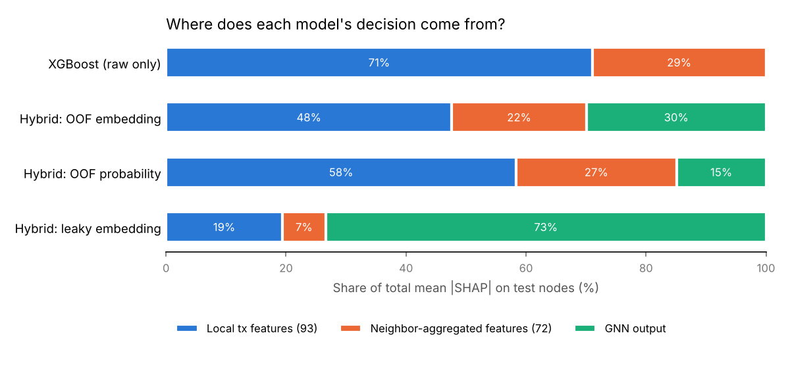
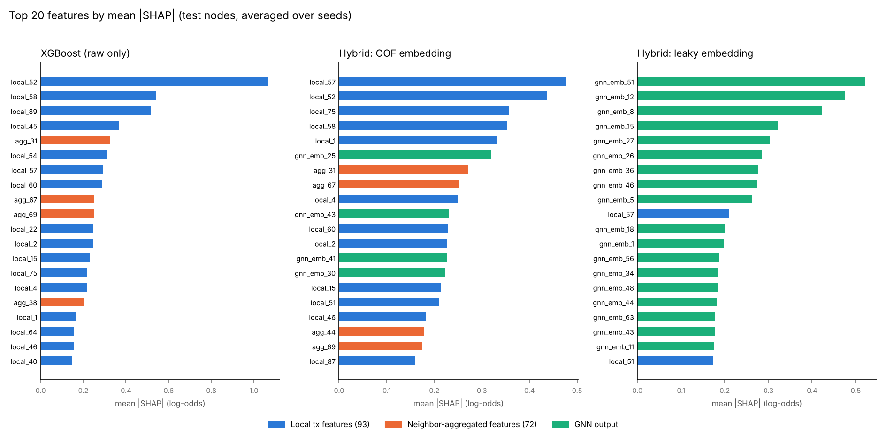
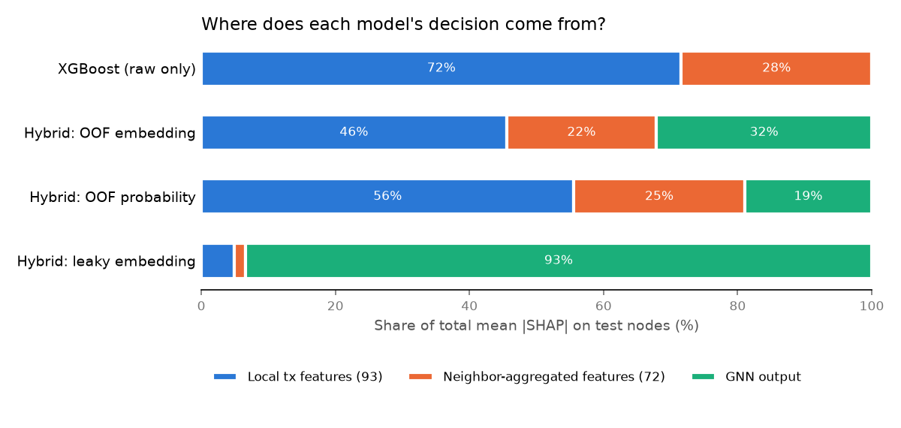
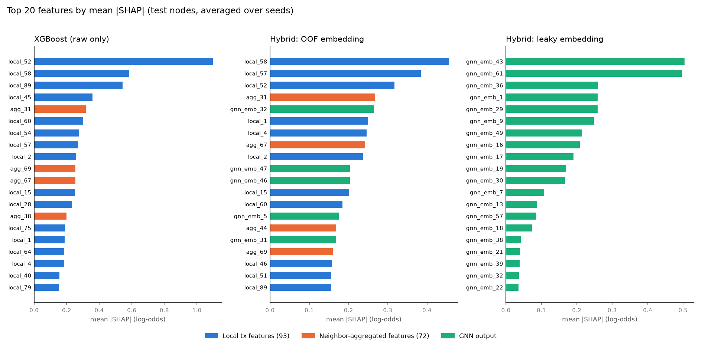
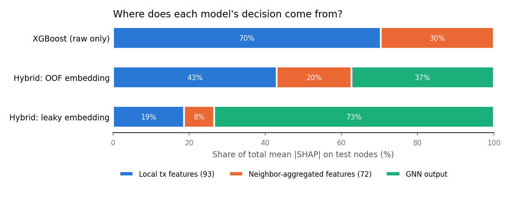
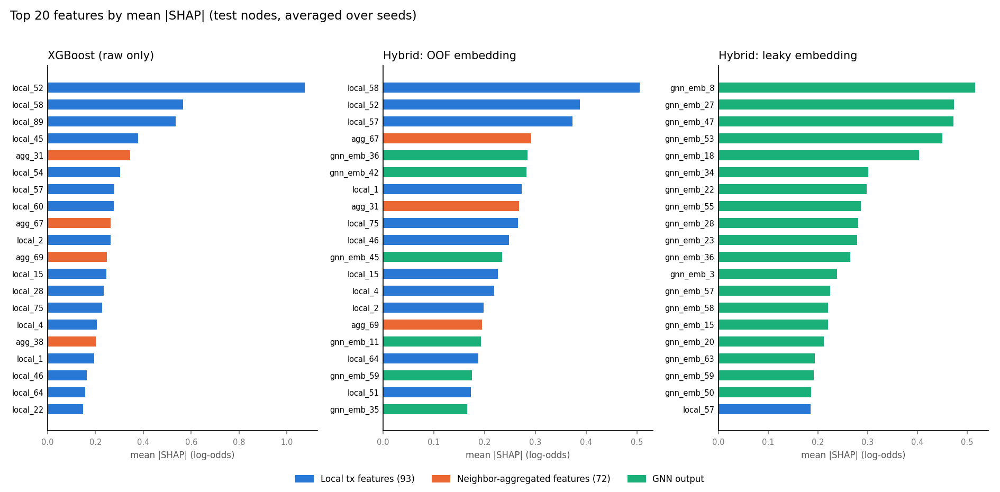

# 2026-2-HAI-ProjectTeam8 · GNN 기반 가상자산 이상거래 탐지

XGBoost vs GCN · GraphSAGE · GAT 비교, 그리고 Skip-GCN 하이브리드. 계획서 3장의 공통 기반을 구현한 저장소입니다.

- 계획서: [`docs/프로젝트_계획서.pdf`](docs/프로젝트_계획서.pdf) · 타임라인: [`docs/타임라인.pdf`](docs/타임라인.pdf)
- 계획서와 코드가 다르면 **이 README와 코드가 우선**입니다 (로더는 PyG가 아니라 원본 CSV를 직접 읽고, 결과 CSV는 `results/metrics/{model}.csv`로 모델별 분리).
- 일정: 11/1 공통 기반 완료 ✅ → 11/12 모델 3종 구현 → 11/19 합치기 → 11/26 마무리 → 11/29 최종 발표
- 합치기 방식 결정(11/12): 하이브리드는 **OOF 임베딩**으로 누수를 막고 만든다 → [하이브리드 누수 처리](#하이브리드-누수-처리-oof-임베딩-방식-b)
- 하이브리드(GCN) 결과: 누수 있음 0.724 → **OOF 0.804** (원본만 0.800) → [GCN 하이브리드 결과](#3-gcn-하이브리드-결과-시드-04)
- GAT: 단독 PR-AUC 0.463, 하이브리드 누수 있음 0.665 → **OOF 0.787** (원본만 0.802, 시드 5개 모두 기준선보다 낮음) → [GAT 결과](#gat-결과)
- **하이브리드 최종 (11/25, 세 모델을 한 환경에서 통일 실행):** 원본만 0.802 / +GCN 0.804 / +SAGE 0.802 / +GAT 0.787 / **+3개 결합(본 실험) 0.799**. 누수를 막으면 XGBoost와 동급이고, 누수가 있으면 0.62~0.72로 떨어짐 → [하이브리드 최종 결과](#하이브리드-최종-결과-gcn--sage--gat-한-환경-통일-실행). 추가 실험(local 93개만): 하이브리드 0.782 vs XGBoost 0.787, 집계 피처를 빼도 XGBoost는 0.015만 하락
- 현재 상태 (11/24): 공통 기반, XGBoost 기준선, GCN(튜닝 후), GraphSAGE 결과와 **GCN·SAGE 하이브리드(OOF 누수 처리)·SHAP 비교까지 main에 합쳐졌습니다.** GAT 코드·지표·하이브리드·SHAP은 11/25 반영. 남은 것: GCN/SAGE 하이브리드를 같은 환경에서 다시 돌려 수치 통일, 최종 비교표와 오류 분석. GNN 단독은 XGBoost(PR-AUC 0.802)보다 낮고(GCN 0.662, SAGE 0.624, GAT 0.463), 누수를 막은 하이브리드는 XGBoost와 동급(0.804 vs 0.800)입니다. 하이브리드 수치는 GCN(클라우드 CPU)과 SAGE(Mac CPU)의 실행 환경·OOF 세부 방식이 달라 서로 직접 비교하지 않습니다.

## 규칙 (모든 조 필수)
1. 데이터는 `common.data.load_data()`, 평가는 `common.metrics`, 저장은 `common.utils`만 사용합니다. 직접 구현 금지.
2. 테스트 구간(시간 단계 35~49)은 튜닝·조기 종료·임계값 결정에 쓰지 않습니다. 최종 보고에만 사용합니다.
3. 시드 0~4 (최소 3회), 결과는 평균 ± 표준편차로 보고합니다.
4. `common/`을 바꿔야 하면 요청하고 전원에게 공지합니다.
5. 결과는 아래 형식으로 저장합니다 (노드 순서 = `load_data()` 순서 = txId 오름차순).

| 파일 | 형식 |
|---|---|
| `results/metrics/{model}.csv` | 한 줄 = (model, seed, split, threshold_type). 같은 키는 재실행 시 덮어씀. 컬럼은 `common/utils.py`의 `METRIC_COLUMNS` |
| `results/pred/pred_{model}_seed{n}.npy` | `(N,)` float32, 불법 확률 |
| `results/emb/emb_{model}_seed{n}.npy` | `(N, 64)` float32, 마지막 GNN 층 임베딩. 용량이 커서(약 50MB) 원칙적으로 git 제외 → 공유 드라이브에 올리기. 현재 GCN·SAGE·GAT 임베딩은 팀 요청으로 저장소에 포함돼 있음(`.gitattributes`의 LFS 규칙 대상) |

model 이름: `xgb`, `gcn`, `sage`, `gat`, 하이브리드는 `hybrid_gcn` 등. threshold_type: `fixed_0.5`, `val_opt`.

## 데이터 준비
원본 CSV 3개(`elliptic_txs_features.csv`, `elliptic_txs_edgelist.csv`, `elliptic_txs_classes.csv`)가 `data/elliptic/` 아래에 있으면 됩니다 (`data/elliptic/raw/`도 인식).

- **방법 A (Kaggle):** Kaggle "Elliptic Data Set" 다운로드 후 압축을 풀어 CSV 3개를 `data/elliptic/`에 둡니다.
- **방법 B (PyG로 1회 내려받기):**
  ```python
  from torch_geometric.datasets import EllipticBitcoinDataset
  EllipticBitcoinDataset(root="data/elliptic")   # raw CSV가 data/elliptic/raw 에 저장됨
  ```

## 실행 환경

| 환경 | 용도 | xgboost | 비고 |
|---|---|---|---|
| Colab (T4 GPU) | GCN 학습 (`results/`) | - | `notebooks/colab_gcn.ipynb` |

## 공통 기반 검증 (완료) — 재현 방법

| split | labeled_nodes | illicit | licit | illicit_ratio |
|---|---|---|---|---|
| train (1~29) | 26,381 | 2,871 | 23,510 | 0.1088 |
| val (30~34) | 3,513 | 591 | 2,922 | 0.1682 |
| test (35~49) | 16,670 | 1,083 | 15,587 | 0.0650 |


## XGBoost 베이스라인 결과

테스트 구간(시간 단계 35~49), 시드 0~4 평균 ± 표준편차. 최종 모델은 Train+Val(1~34)로 다시 학습했고, 테스트는 1회만 평가했습니다. **환경: Colab CPU, xgboost 3.4.1.**

| 지표 | 임계값 0.5 | 검증 구간 최적 임계값 | 설명 |
|---|---|---|---|
| PR-AUC | 0.802 ± 0.002 | 0.802 ± 0.002 | **주 지표.** 임계값을 바꿔가며 그린 정밀도-재현율 곡선 아래 넓이(0~1, 클수록 좋음). 불법이 드문 데이터에서 신뢰할 만하고 임계값에 영향받지 않음. 무작위 예측은 테스트 불법 비율(0.065) |
| ROC-AUC | 0.937 ± 0.002 | 0.937 ± 0.002 | 불법 거래가 정상보다 높은 점수를 받을 확률(0.5=무작위, 1=완벽). 불법이 드물면 실제보다 좋게 보일 수 있어 보조로만 봄 |
| Precision | 0.818 ± 0.041 | 0.874 ± 0.048 | 정밀도. 불법이라고 예측한 것 중 진짜 불법의 비율. 낮으면 오탐(정상을 불법으로 오인)이 많다는 뜻 |
| Recall | 0.737 ± 0.001 | 0.733 ± 0.003 | 재현율. 진짜 불법 중 모델이 잡아낸 비율. 낮으면 놓치는 불법이 많다는 뜻 |
| **F1 (불법)** | **0.775 ± 0.018** | **0.797 ± 0.019** | 정밀도와 재현율의 조화평균. 둘 다 높아야 높음 |

### 결과 파일 위치
| 파일 | 내용 |
|---|---|
| `results/summary.csv` | 모델·임계값별 평균/표준편차 요약 |
| `results/metrics/xgb.csv` | 시드·분할·임계값별 상세 |
| `results/pred/pred_xgb_seed{n}.npy` | 시드별 불법 확률 (오류 분석·하이브리드용) |
| `results/timestep_f1_xgb.csv` | 시간 단계별 F1 |
| `results/xgb_feature_importance.csv`, `results/xgb_tuning.csv` | 특징 중요도, 튜닝 기록 |

## GCN 결과

테스트 구간(시간 단계 35~49), 시드 0~4 평균 ± 표준편차. 학습·평가 절차는 XGBoost와 같습니다 (Train 학습 + 검증 조기 종료 → Train+Val 재학습 → 테스트 1회 평가). **환경: Colab L4 GPU. 하이퍼파라미터는 검증 PR-AUC 기준 튜닝 후 값 (조기 종료 `patience=100`).**

| 지표 | 임계값 0.5 | 검증 구간 최적 임계값 | 설명 |
|---|---|---|---|
| PR-AUC | 0.662 ± 0.024 | 0.662 ± 0.024 | **주 지표.** 임계값과 무관 (XGBoost 0.802) |
| ROC-AUC | 0.888 ± 0.007 | 0.888 ± 0.007 | 불법이 정상보다 높은 점수를 받을 확률. 보조 지표 (XGBoost 0.937) |
| Precision | 0.724 ± 0.063 | 0.870 ± 0.030 | 불법이라고 예측한 것 중 진짜 불법의 비율 |
| Recall | 0.590 ± 0.017 | 0.452 ± 0.024 | 진짜 불법 중 잡아낸 비율 |
| **F1 (불법)** | **0.649 ± 0.026** | **0.595 ± 0.025** | 정밀도와 재현율의 조화평균 (XGBoost 0.775 / 0.797) |

지표와 임계값의 뜻은 [XGBoost 결과](#xgboost-베이스라인-결과)의 설명과 같습니다.

#### 테스트 구간 분리 (35~42 / 43~49)

테스트(35~49)를 time step 43 전후로 나눠서 따로 계산한 값입니다. 모델 학습·분할은 그대로이고, **테스트 예측값을 구간별로 나눠 점수만 다시 낸 것**입니다 (배경은 아래 [모델 비교](#모델-비교-xgboost-vs-gcn) 섹션).

| 구간 | 라벨 노드 | 불법 (비율) | PR-AUC | 평균 F1 | XGBoost PR-AUC / F1 |
|---|---|---|---|---|---|
| **35~42** | 9,983 | 914 (9.2%) | **0.782 ± 0.019** | 0.596 | 0.921 / 0.885 |
| 43~49 | 6,687 | 169 (2.5%) | 0.040 ± 0.004 | 0.025 | 0.046 / 0.034 |
| 전체 35~49 | 16,670 | 1,083 (6.5%) | 0.662 ± 0.024 | — | 0.802 / — |

- 무작위 예측의 PR-AUC 기준선은 그 구간의 불법 비율입니다 (35~42: 0.092, 43~49: 0.025, 전체: 0.065). **43~49는 GCN이 기준선의 1.6배 수준으로 사실상 구분 능력이 없고**(XGBoost도 비슷), 결과는 35~42 중심으로 해석하되 전체 수치도 함께 보고합니다.
- 구간별 PR-AUC는 시드마다 해당 구간의 테스트 노드만 모아 계산한 평균 ± 표준편차이고, `notebooks/colab_gcn_tune.ipynb`의 12번 셀로 다시 계산할 수 있습니다 (`results/pred/pred_gcn_seed{n}.npy` 사용, 별도 CSV는 저장하지 않음). 저장소의 `pred` 파일이 최종 실행 결과일 때 같은 값이 나옵니다.
- 구간별 평균 F1은 검증 구간 최적 임계값 기준이고 시드와 단계별로 평균낸 값입니다 (`results/timestep_f1_gcn.csv`).
- 시간 단계별 불법 건수는 아래 [테스트 구간 시간 단계별 불법 거래 수](#테스트-구간-시간-단계별-불법-거래-수)를 보세요.

- 학습 6.2 ± 1.9초 · 추론 0.050초 (Colab L4 GPU, 전체 그래프 1회 추론). 파라미터 14,914개. XGBoost는 환경이 달라 속도를 직접 비교할 수 없고, 1차 결과(T4)와도 장치가 달라 직접 비교할 수 없습니다.
- 설정: 2층 GCN(`hidden=64`, 마지막 conv 출력이 64차원 임베딩) + 선형 분류기, full-batch 학습, `dropout=0.5`, Adam `lr=0.01`, `weight_decay=5e-4`, 최대 500 에폭, 검증 PR-AUC 기준 조기 종료(`patience=100`), 클래스 가중치는 학습 구간 정상/불법 비.
- 시드별 테스트 PR-AUC는 0.660 / 0.626 / 0.666 / 0.666 / 0.693이고, 조기 종료 시점(best_epoch)은 144 / 167 / 203 / 306 / 224입니다. 검증 PR-AUC는 0.893 ± 0.006입니다.
- 검증 최적 임계값은 시드마다 0.74~0.90으로 높고, 임계값 0.5보다 F1이 낮습니다. 검증 구간의 불법 비율(16.8%)이 테스트(6.5%)보다 높아 검증에서 고른 임계값이 테스트로 잘 옮겨지지 않는 것으로 보입니다.
- **같은 설정으로 다시 돌려도 값이 조금씩 달라집니다.** 같은 조합(`lr 0.01 / dropout 0.3 / wd 1e-3`)을 반복 실행한 검증 PR-AUC 평균이 patience 30에서 0.846 / 0.850 / 0.865, patience 100에서 0.886 / 0.886 / 0.891이었습니다. 시드를 고정해도 GPU 연산 순서가 달라지는 것이 원인으로 추정되며, 직접 확인하지는 않았습니다. 표의 값은 한 번 실행한 결과입니다.

### GCN 하이퍼파라미터 튜닝

계획서 4.1 범위(lr × dropout × weight_decay, 8개 조합)를 시드 0~4로 학습하고 **검증 PR-AUC 평균**으로 골랐습니다. 테스트 구간은 선택에 쓰지 않았습니다. 조기 종료 patience 30으로 먼저 돌린 뒤, patience를 100(최대 500 에폭)으로 늘려 다시 돌렸습니다.

| 조합 | lr | dropout | weight_decay | 검증 PR-AUC (patience 100) | 표준편차 | 검증 PR-AUC (patience 30) | 표준편차 |
|---|---|---|---|---|---|---|---|
| **1 (선택)** | **0.01** | **0.5** | **5e-4** | **0.8969** | **0.0040** | 0.8515 | 0.0405 |
| 2 | 0.005 | 0.5 | 5e-4 | 0.8910 | 0.0113 | 0.8420 | 0.0577 |
| 3 | 0.01 | 0.5 | 1e-3 | 0.8889 | 0.0075 | 0.8439 | 0.0483 |
| 4 | 0.01 | 0.3 | 5e-4 | 0.8882 | 0.0093 | 0.8360 | 0.0385 |
| 5 | 0.005 | 0.5 | 1e-3 | 0.8862 | 0.0045 | 0.8308 | 0.0571 |
| 6 | 0.01 | 0.3 | 1e-3 | 0.8855 | 0.0065 | 0.8651 | 0.0356 |
| 7 | 0.005 | 0.3 | 5e-4 | 0.8765 | 0.0156 | 0.8198 | 0.0510 |
| 8 | 0.005 | 0.3 | 1e-3 | 0.8739 | 0.0034 | 0.8118 | 0.0515 |

- **patience 변경이 하이퍼파라미터 조합보다 훨씬 큰 효과**를 냈습니다. 같은 조합(`lr 0.01 / dropout 0.3 / wd 1e-3`)에서 patience 30은 검증 PR-AUC 0.850 ± 0.030(best_epoch 22~136), patience 100은 0.891 ± 0.010(best_epoch 154~293)이었습니다 (`results/tuning/gcn/patience_p30_vs_p100_do0.3.csv`). patience 30은 학습을 일찍 끊어 시드 편차가 커졌습니다.
- 테스트 PR-AUC 참고값 (Colab 실행 출력 기준, 결과 파일은 덮어써져 저장소에 없음): 1차(튜닝 전) 0.482 ± 0.160 → 8조합 튜닝 후 patience 30 0.565 ± 0.127 → patience 100 0.661 ± 0.021 → 최종 0.662 ± 0.024.
- **조합 간 차이는 작습니다.** patience 100에서 1위와 2위의 차이는 0.006으로 같은 설정을 반복 실행했을 때의 변동(약 0.005~0.006)과 비슷해서 우열을 주장하기 어렵습니다. 인자별 평균은 dropout 0.5가 0.3보다 +0.010, lr 0.01이 0.005보다 +0.008, weight_decay 5e-4가 1e-3보다 +0.005로 경향은 약합니다. 계획서 기본값(lr 0.005, dropout 0.5, wd 5e-4)이 2위입니다.
- patience 30 그리드의 순위는 조기 종료 시점의 잡음에 흔들렸습니다. lr 0.005 조합 중 일부 시드의 best_epoch가 최대 456까지 가서 최대 에폭 500에 가까웠으므로, lr 0.005 쪽이 약간 불리하게 측정됐을 수 있습니다.
- **모델 간 비교 시 주의:** 조기 종료 patience 설정이 결과에 크게 영향을 주므로, 다른 모델과 비교할 때는 patience가 같은 조건인지 확인해야 합니다 (GCN 최종 설정은 patience 100 / 최대 500 에폭).
- 이 값들은 `notebooks/colab_gcn_tune.ipynb`로 만들었습니다.

### GCN 결과 파일 위치
| 파일 | 내용 |
|---|---|
| `results/metrics/gcn.csv` | 시드·분할·임계값별 상세 (`notes`에 best_epoch 기록) |
| `results/pred/pred_gcn_seed{n}.npy` | 시드별 불법 확률 (오류 분석·하이브리드용) |
| `results/emb/emb_gcn_seed{n}.npy` | 시드별 64차원 임베딩 (약 50MB씩). 팀 요청으로 git에 포함(`git add -f`), 같은 파일이 공유 드라이브 `gcn_results_tuned/emb`에도 있음 |
| `results/timestep_f1_gcn.csv` | 시간 단계별 F1 |
| `results/summary.csv` | XGBoost·GCN 요약 (`scripts/collect_results.py`로 재생성) |
| `results/tuning/gcn/grid_p100.csv`, `grid_p30.csv` | 8조합 그리드 요약 (patience 100 / 30) |
| `results/tuning/gcn/patience_p30_vs_p100_do0.3.csv` | patience 30 vs 100 비교 (조합 `lr 0.01 / dropout 0.3 / wd 1e-3`) |
| `notebooks/colab_gcn_tune.ipynb` | 튜닝·최종 학습 Colab 노트북 |

## 하이브리드 누수 처리: OOF 임베딩 (방식 B)

### 1. 왜 누수 처리를 해야 하나

하이브리드는 이렇게 만듭니다.

```
GNN을 학습 → 노드마다 64차원 임베딩을 뽑음 → [원본 165개 | 임베딩 64개]를 XGBoost에 입력
```

지금 저장되는 임베딩(`emb_{model}_seed{n}.npy`)은 **Train+Val(시간 단계 1~34)의 정답을 보고 학습한 GNN**에서 나옵니다.
즉 1~34 노드의 임베딩에는 이미 그 노드의 정답이 일부 새겨져 있음.

이 임베딩으로 XGBoost를 학습하면 두 가지 문제가 발생.

| 문제 | 설명 |
|---|---|
| ① 학습 때 임베딩이 지나치게 정답 같음 | 학습 노드의 임베딩은 정답을 이미 본 모델이 만든 것이라 라벨과 너무 잘 맞음. XGBoost가 "임베딩만 믿으면 되네"라고 과하게 의존.|
| ② 테스트 때는 그 효과가 사라짐 | 테스트 노드(35~49)의 임베딩은 정답을 본 적 없는 노드의 것이라 훨씬 덜 정확합니다. 학습 때 본 것과 분포가 달라져서 성능이 떨어지거나, 검증 점수만 부풀려짐. |

결과적으로 **"하이브리드가 XGBoost보다 좋아졌는가?"를 정직하게 판단할 수 없게 됨.**
이것은 테스트 구간의 정답이 새는 문제가 아니라(규칙 2는 그대로 지켜짐), **학습 데이터 쪽에서 정답이 새는 문제**. 그래서 따로 처리해야 함.

### 2. OOF 방식: 각 노드의 임베딩을 "그 노드의 정답을 못 본 GNN"에서 받는다

1. 시간 단계 1~34를 시간 순서대로 연속된 5개 블록으로 나눕니다 (1~7 / 8~14 / 15~21 / 22~28 / 29~34). 랜덤 분할이 아닌 이유는 같은 시간대 노드끼리 간선으로 이어져 있어서, 섞으면 이웃을 통해 정답이 새기 때문입니다.
2. 블록 k의 정답은 숨기고, 나머지 블록의 정답으로 GNN을 학습합니다 (하이퍼파라미터·시드 동일, 에폭 수는 그 시드의 본 학습 `best_epoch`로 고정).
3. 학습된 GNN으로 전체 그래프를 forward 해서 **블록 k 노드의 임베딩만** 가져옵니다. 블록 k의 피처·간선은 쓰지만 정답은 쓰지 않았습니다.
4. 폴드마다 GNN을 따로 학습하면 임베딩의 좌표축이 서로 달라집니다. 그래서 블록 k의 **라벨 없는 노드(y=2)** 로 "폴드 임베딩 → 기준 임베딩"의 회전·크기·이동(Procrustes 정렬)을 구해 블록 k 전체에 적용합니다. 정렬에 정답은 쓰이지 않습니다.
5. 테스트 구간(35~49) 노드는 정답을 본 적 없는 노드이므로 기준 임베딩(저장된 전체 재학습 GNN의 임베딩)을 그대로 씁니다.

### 3. GCN 하이브리드 결과 (시드 0~4)

> **참고용:** 이 절은 모델별로 따로 돌린 결과입니다 (실행 환경·OOF 방식이 서로 다름). 보고서 비교표는 [하이브리드 최종 결과](#하이브리드-최종-결과-gcn--sage--gat-한-환경-통일-실행)의 통일 실행 숫자를 씁니다.

**테스트 PR-AUC (35~49, 시드 평균 ± 표준편차)**

| 입력 | 테스트 PR-AUC | 검증 PR-AUC | 학습 PR-AUC |
|---|---|---|---|
| 원본 165개만 (`xgb_check`, 베이스라인 재현) | 0.8004 ± 0.0020 | 0.9894 | 1.000 |
| 원본 + 임베딩, **누수 있음** (`hybrid_gcn_naive`) | 0.7244 ± 0.0083 | 0.9980 | 1.000 |
| 원본 + **OOF 임베딩** (`hybrid_gcn`) | **0.8041 ± 0.0039** | 0.9895 | 1.000 |

공식 `xgb` 베이스라인은 0.802 ± 0.002이고, `xgb_check`와 0.002 차이로 재현됩니다.

**시드별 테스트 PR-AUC (같은 시드끼리 짝지어 비교)**

| 시드 | 기준선 (`xgb_check`) | 누수 있음 | OOF | OOF − 기준선 |
|---|---|---|---|---|
| 0 | 0.8014 | 0.7204 | 0.8052 | +0.0038 |
| 1 | 0.8032 | 0.7142 | 0.8036 | +0.0005 |
| 2 | 0.8006 | 0.7234 | 0.8003 | −0.0003 |
| 3 | 0.7981 | 0.7274 | 0.8101 | +0.0121 |
| 4 | 0.7990 | 0.7364 | 0.8012 | +0.0022 |
| **평균 ± 표준편차** | **0.8004 ± 0.0020** | 0.7244 ± 0.0083 | **0.8041 ± 0.0039** | **+0.0036 ± 0.0050** |


**F1 · 정밀도 · 재현율 (테스트)**

| 입력 | 임계값 | F1 | 정밀도 | 재현율 |
|---|---|---|---|---|
| 원본만 | 0.5 | 0.767 ± 0.030 | 0.801 | 0.737 |
| 원본만 | 검증 최적 | 0.791 ± 0.014 | 0.859 | 0.734 |
| 누수 있음 | 0.5 | 0.738 ± 0.006 | 0.914 | 0.619 |
| 누수 있음 | 검증 최적 | 0.736 ± 0.009 | 0.934 | 0.609 |
| OOF | 0.5 | 0.789 ± 0.012 | 0.863 | 0.727 |
| OOF | 검증 최적 | **0.806 ± 0.009** | 0.919 | 0.718 |

**테스트 구간별 PR-AUC (시드 평균)**

| 구간 | 불법 건수 | 원본만 | 누수 있음 | OOF |
|---|---|---|---|---|
| 35~42 | 914 | 0.9201 | 0.8477 | 0.9215 |
| 43~49 | 169 | 0.0455 | 0.0367 | 0.0477 |

**임베딩 vs 원본 피처의 기여 (XGBoost gain 비중, 시드 평균):** 누수 있음 임베딩 91% / 원본 9%, OOF 임베딩 74% / 원본 26%.

## GCN SHAP 비교

SAGE 조의 `analysis/shap_compare.py`를 **그대로** GCN에 적용했습니다. XGBoost 원본만 / 하이브리드 3종에 `TreeExplainer`를 적용해, 테스트 노드(35~49)의 평균 |SHAP|을 피처 그룹별로 합산했습니다 (시드 0~4 평균). 네 모델 모두 같은 XGBoost 설정·절차(베이스라인 튜닝값 고정, Train 조기 종료 → Train+Val 재학습)입니다.

| 모델 | 자기 거래 정보 (local 93) | 이웃 집계 (agg 72) | GNN 출력 |
|---|---|---|---|
| XGBoost 원본만 | 71.0% ± 2.9% | 29.0% ± 2.9% | — |
| 하이브리드 – OOF 임베딩 | 47.6% ± 1.1% | 22.5% ± 0.6% | 29.9% ± 1.4% |
| 하이브리드 – OOF 확률 | 58.4% ± 1.5% | 26.7% ± 2.0% | 14.9% ± 1.6% |
| 하이브리드 – 누수 임베딩 | 19.4% ± 1.1% | 7.2% ± 0.8% | 73.4% ± 1.8% |






### GCN SHAP 결과 파일 위치
| 파일 | 내용 |
|---|---|
| `analysis/shap_compare.py` | 실행 코드 (SAGE 조 PR에서 main에 포함, `python -m analysis.shap_compare --gnn gcn --oof-dir <OOF 임베딩·확률 위치>`) |
| `results/shap/gcn/group_share.csv` | 모델·시드별 그룹 비중, 트리 수 |
| `results/shap/gcn/top20.csv`, `feature_importance.csv` | 모델별 피처 기여도 (시드 평균, 순위 포함) |

## GraphSAGE 결과

테스트 구간(시간 단계 35~49), 시드 0~4 평균 ± 표준편차. 학습·평가 절차는 XGBoost·GCN과 같습니다 (Train 학습 + 검증 조기 종료 → Train+Val 재학습 → 테스트 1회 평가). **환경: Colab T4 GPU. 팀 공통 재학습 설정(patience 100, 최대 500 에폭)으로 다시 학습한 결과.**

| 지표 | 임계값 0.5 | 검증 구간 최적 임계값 | 설명 |
|---|---|---|---|
| PR-AUC | 0.624 ± 0.037 | 0.624 ± 0.037 | **주 지표.** 임계값과 무관 (XGBoost 0.802) |
| ROC-AUC | 0.904 ± 0.006 | 0.904 ± 0.006 | 불법이 정상보다 높은 점수를 받을 확률. 보조 지표 (XGBoost 0.937) |
| Precision | 0.663 ± 0.084 | 0.767 ± 0.068 | 불법이라고 예측한 것 중 진짜 불법의 비율 |
| Recall | 0.625 ± 0.023 | 0.557 ± 0.025 | 진짜 불법 중 잡아낸 비율 |
| **F1 (불법)** | **0.641 ± 0.034** | **0.645 ± 0.031** | 정밀도와 재현율의 조화평균 (XGBoost 0.775 / 0.797) |

지표와 임계값의 뜻은 [XGBoost 결과](#xgboost-베이스라인-결과)의 설명과 같습니다.

- 학습 6.9 ± 2.5초 · 추론 0.068초 (T4 GPU, 전체 그래프 1회 추론). 파라미터 29,570개. XGBoost는 환경이 달라 속도를 직접 비교할 수 없습니다.
- 설정: 2층 GraphSAGE(`SAGEConv`, `aggr=mean`, `hidden=64`, 마지막 conv 출력이 64차원 임베딩) + 선형 분류기, full-batch 학습, `dropout=0.3`, Adam `lr=0.005`, `weight_decay=1e-3`, 최대 500 에폭, 검증 PR-AUC 기준 조기 종료(`patience=100`), 클래스 가중치는 학습 구간 정상/불법 비.
- 시드별 테스트 PR-AUC는 0.613 / 0.588 / 0.662 / 0.665 / 0.592이고, 조기 종료 시점(best_epoch)은 123 / 138 / 128 / 232 / 121입니다. 검증 PR-AUC는 0.955 ± 0.006, 검증 최적 임계값은 0.846 ± 0.060입니다.
- 시간 단계별 평균 F1(검증 구간 최적 임계값)은 35~42 구간 0.690, 43~49 구간 0.022로, 다른 모델과 마찬가지로 43 이후 성능이 크게 떨어집니다.
- 이전 설정(patience 30, 최대 300 에폭)의 결과는 PR-AUC 0.611 ± 0.031, F1(검증 최적 임계값) 0.606 ± 0.030이었습니다. 학습을 더 오래 이어 갈 수 있게 되면서 재현율이 0.488에서 0.557로 올랐습니다.

### GraphSAGE 하이퍼파라미터 튜닝

계획서 4.1 범위(lr × dropout × weight_decay, 8개 조합)를 시드 0~2로 학습하고 **검증 PR-AUC 평균**으로 골랐습니다. 테스트 구간은 선택에 쓰지 않았습니다. 튜닝은 재학습 설정 이전(patience 30, 최대 300 에폭)에 진행했고, 고른 설정을 그대로 재학습에 썼습니다.

| 조합 | lr | dropout | weight_decay | 검증 PR-AUC 평균 | 표준편차 |
|---|---|---|---|---|---|
| **6 (선택)** | **0.005** | **0.3** | **0.001** | **0.9551** | **0.0039** |
| 5 | 0.005 | 0.3 | 0.0005 | 0.9531 | 0.0034 |
| 7 | 0.005 | 0.5 | 0.0005 | 0.9495 | 0.0053 |
| 2 | 0.010 | 0.3 | 0.001 | 0.9488 | 0.0026 |
| 4 | 0.010 | 0.5 | 0.001 | 0.9484 | 0.0044 |
| 3 | 0.010 | 0.5 | 0.0005 | 0.9476 | 0.0071 |
| 8 | 0.005 | 0.5 | 0.001 | 0.9474 | 0.0036 |
| 1 | 0.010 | 0.3 | 0.0005 | 0.9457 | 0.0056 |

### GraphSAGE 결과 파일 위치
| 파일 | 내용 |
|---|---|
| `results/metrics/sage.csv` | 시드·분할·임계값별 상세 (`notes`에 best_epoch 기록) |
| `results/pred/pred_sage_seed{n}.npy` | 시드별 불법 확률 (오류 분석·하이브리드용) |
| `results/emb/emb_sage_seed{n}.npy` | 시드별 64차원 임베딩 (약 50MB씩, sage 브랜치에 업로드) |
| `results/timestep_f1_sage.csv` | 시간 단계별 F1 |

## SAGE 하이브리드 (Skip-GCN, OOF 누수 처리)

SAGE 출력(임베딩 또는 불법 확률)을 원본 피처 165개 옆에 붙여 XGBoost를 다시 학습했습니다. **XGBoost 설정과 절차는 베이스라인과 같게 고정**하고 입력만 바꿨습니다. 테스트 구간(35~49), 시드 0~4 평균 ± 표준편차. **환경: Mac CPU** (비교 기준인 XGBoost도 같은 환경에서 다시 돌린 값).

### 왜 누수 처리가 필요한가
`results/emb/`의 SAGE 임베딩은 시간 단계 1~34의 정답으로 재학습한 모델에서 나왔습니다. 그대로 XGBoost에 붙이면 학습·검증 노드의 임베딩에 정답이 새겨져 있어, 검증 PR-AUC는 거의 1이 되고 테스트에서는 그 효과가 사라집니다 (학습 쪽 누수). 아래 표의 "기존 임베딩 그대로"가 그 경우입니다.

### 방법: 시간 단계 OOF (out-of-fold)
1. 시간 단계 1~34를 연속된 5개 묶음으로 나눕니다: 1~7 / 8~14 / 15~21 / 22~28 / 29~34.
2. 묶음마다 **그 묶음을 뺀 나머지 묶음의 정답으로만** SAGE를 학습해, 그 묶음 노드의 출력(임베딩·불법 확률)을 만듭니다. Elliptic은 간선이 같은 시간 단계 안에만 있어서, 이 모델은 빠진 묶음의 정답을 그래프를 통해서도 보지 않습니다.
3. 테스트(35~49) 노드는 5개 묶음 모델 출력의 평균을 씁니다.
4. 묶음별 SAGE는 최종 SAGE 설정(lr 0.005, dropout 0.3, weight_decay 1e-3)과 시드별 best_epoch만큼 학습합니다.
5. 묶음마다 임베딩 좌표계가 다를 수 있어, 미분류 노드(정답 없음)만으로 첫 묶음 모델 좌표계에 선형 정렬한 버전도 함께 비교했습니다 (정렬 R² 약 0.96).

### 결과

> **참고용:** 이 절은 모델별로 따로 돌린 결과입니다 (실행 환경·OOF 방식이 서로 다름). 보고서 비교표는 [하이브리드 최종 결과](#하이브리드-최종-결과-gcn--sage--gat-한-환경-통일-실행)의 통일 실행 숫자를 씁니다.
| 방법 | PR-AUC | F1 (검증 최적 임계값) | 정밀도 | 재현율 |
|---|---|---|---|---|
| XGBoost 원본만 (같은 환경·설정 기준) | 0.800 ± 0.002 | 0.798 ± 0.009 | 0.875 | 0.734 |
| 기존 SAGE 임베딩 그대로 (누수) | 0.623 ± 0.048 | 0.644 ± 0.035 | 0.790 | 0.549 |
| **OOF 임베딩 (팀 방식)** | **0.804 ± 0.003** | **0.806 ± 0.004** | 0.950 | 0.700 |
| OOF 임베딩 + 좌표계 정렬 | 0.800 ± 0.003 | 0.804 ± 0.004 | 0.941 | 0.702 |
| OOF 불법 확률 1열 | 0.807 ± 0.004 | 0.808 ± 0.004 | 0.951 | 0.703 |

- **누수가 있으면 XGBoost 단독보다 PR-AUC가 약 0.18 낮아집니다.** 검증 PR-AUC는 0.999로 거의 만점인데 테스트는 0.623이라, 학습 쪽 누수가 실제로 성능을 망친다는 것을 보여 줍니다. → 누수 처리가 필수입니다.
- **누수를 막은 하이브리드는 XGBoost 단독보다 아주 조금 높습니다** (OOF 임베딩 +0.004, 시드 5개 모두 기준보다 높음). 다만 차이가 시드 간 편차(±0.002~0.003) 수준이라, 그래프 정보의 추가 효과는 작습니다.
- **정밀도는 0.875 → 0.950으로 오르고 재현율은 0.734 → 0.700으로 조금 내려갑니다.** 같은 수준의 PR-AUC에서 오탐이 줄어드는 쪽으로 바뀌었습니다.
- **좌표계 정렬은 효과가 없었습니다.** 정렬 R²가 약 0.96으로, 묶음별 모델의 좌표계가 원래 비슷했습니다. → 팀 방식(정렬 없음)을 그대로 써도 됩니다.
- **43단계 이후 성능 붕괴는 그대로입니다.** 35~42 / 43~49 구간 PR-AUC: XGBoost 0.921 / 0.046, OOF 임베딩 하이브리드 0.922 / 0.051.

시간(초)은 Mac CPU에서 잰 값이라 Colab 결과와 비교하지 않습니다. 같은 설정의 XGBoost가 Colab에서는 0.802, Mac에서는 0.800으로, 환경 차이는 약 0.002입니다.

### SAGE 하이브리드 결과 파일 위치
| 파일 | 내용 |
|---|---|
| `hybrid/skip_gcn.py` | OOF + 하이브리드 실행 코드 (`python -m hybrid.skip_gcn --gnn sage`) |
| `results/metrics/xgb_rawonly_fixed.csv` | 같은 환경·설정의 XGBoost 원본만 (비교 기준) |
| `results/metrics/hybrid_sage_{oofemb, oofemb_aligned, oofprob, leaky}.csv` | 하이브리드 4종 상세 |
| `results/pred/pred_{위 이름}_seed{n}.npy` | 시드별 불법 확률 |
| `results/timestep_f1_{위 이름}.csv` | 시간 단계별 F1 |
| `results/oof/oofprob_sage_seed{n}.npy` | SAGE OOF 불법 확률 (SHAP 등에서 재사용) |

## SAGE SHAP 비교

XGBoost 원본만 / 하이브리드 3종에 `TreeExplainer`를 적용해, 테스트 노드(35~49)의 평균 |SHAP|을 피처 그룹별로 합산했습니다 (시드 0~4 평균). 네 모델 모두 같은 XGBoost 설정·절차(베이스라인 튜닝값 고정, Train 조기 종료 → Train+Val 재학습)로 학습했습니다. **환경: MacBook M3 CPU.**

| 모델 | 자기 거래 정보 (local 93) | 이웃 집계 (agg 72) | GNN 출력 |
|---|---|---|---|
| XGBoost 원본만 | 71.6% ± 3.9% | 28.4% ± 3.9% | — |
| 하이브리드 – OOF 임베딩 | 45.5% ± 0.2% | 22.4% ± 0.8% | 32.1% ± 0.8% |
| 하이브리드 – OOF 확률 | 55.6% ± 2.1% | 25.5% ± 2.5% | 19.0% ± 1.2% |
| 하이브리드 – 누수 임베딩 | 4.9% ± 1.7% | 1.7% ± 0.5% | 93.4% ± 1.9% |

- 피처 그룹은 Weber et al. (2019) 기준입니다 (시간 단계 열 제외): 0~92번 = 거래 자체 정보(local), 93~164번 = 1-hop 이웃 거래 집계(agg). 임베딩의 각 차원은 의미가 없으므로 64개를 합산해서 봅니다.
- **누수 임베딩은 판단의 93%를 임베딩에 의존**하고, 상위 20개 피처가 모두 임베딩입니다 → 학습 라벨이 새겨진 임베딩을 "베끼는" 현상 (테스트 PR-AUC 0.623).
- **OOF 임베딩은 비중 32%** 이며, 기존 핵심 피처(local_52·57·58, agg_31 등)는 상위권에 그대로 남습니다 (하이브리드 상위 20개의 원본 피처 15개 중 12개가 XGBoost 상위 20개와 겹침).
- 임베딩이 기존 피처의 기여도를 대신 가져간 형태입니다 (평균 |SHAP| 합계: local 8.09 → 5.52, −32% / agg 3.32 → 2.71, −18%). 새 정보를 더하기보다 같은 정보를 다시 담은 것으로 보이며, 성능 향상(+0.004)이 작은 이유와 일치합니다.
- SAGE는 자기 노드 표현을 이웃 평균과 따로 받아 임베딩에 담기 때문에, 이웃 집계보다 자기 거래 정보의 몫을 더 많이 대신한 것으로 보입니다.
- 주의: SHAP 비중은 "모델이 무엇에 기댔는가"를 보여 주며, 정보가 겹치는 피처끼리는 기여도를 나눠 갖습니다. 상위 20개 그래프는 모델마다 x축 범위가 다릅니다.





### SAGE SHAP 결과 파일 위치
| 파일 | 내용 |
|---|---|
| `analysis/shap_compare.py` | 실행 코드 (`python -m analysis.shap_compare --gnn sage --oof-dir <OOF 임베딩 위치>`) |
| `results/shap/sage/group_share.csv` | 모델·시드별 그룹 비중, 트리 수 |
| `results/shap/sage/top20.csv`, `feature_importance.csv` | 모델별 피처 기여도 (시드 평균, 순위 포함) |
| `results/shap/sage/group_share.png`, `top20.png` | 그래프 (발표 자료용) |

OOF 임베딩(`oofemb_sage_seed{n}.npy`, 시드당 52MB)은 git에 포함하지 않았습니다. `python -m hybrid.skip_gcn --gnn sage`로 다시 만들 수 있습니다 (시드는 고정되지만, 실행 환경(CPU/GPU)이 다르면 GNN 결과가 소수점 수준에서 달라질 수 있습니다).

## GAT 결과

테스트 구간(시간 단계 35~49), 시드 0~4 평균 ± 표준편차. 학습·평가 절차는 XGBoost·GCN·GraphSAGE와 같습니다 (Train 학습 + 검증 조기 종료 → Train+Val 재학습 → 테스트 1회 평가). **환경: Colab T4 GPU.** 실행 노트북: `notebooks/colab_gat_poster.ipynb`.

| 지표 | 임계값 0.5 | 검증 구간 최적 임계값 | 설명 |
|---|---|---|---|
| PR-AUC | 0.463 ± 0.058 | 0.463 ± 0.058 | **주 지표.** 임계값과 무관 (XGBoost 0.802) |
| ROC-AUC | 0.863 ± 0.011 | 0.863 ± 0.011 | 보조 지표 (XGBoost 0.937) |
| Precision | 0.481 ± 0.012 | 0.559 ± 0.050 | 불법이라고 예측한 것 중 진짜 불법의 비율 |
| Recall | 0.586 ± 0.050 | 0.354 ± 0.053 | 진짜 불법 중 잡아낸 비율 |
| **F1 (불법)** | **0.527 ± 0.020** | **0.433 ± 0.054** | 정밀도와 재현율의 조화평균 (XGBoost 0.775 / 0.797) |

```bash
python -m models.gat --data-root data/elliptic --seeds 0 1 2 3 4 --heads 8 --lr 0.01 --dropout 0.3 --weight-decay 5e-4 --patience 100 --max-epochs 500
```

- 설정: 2층 GAT(`GATConv`, heads 8 × 헤드당 8차원 = 64차원 임베딩) + 선형 분류기, full-batch 학습, `dropout=0.3`(어텐션 계수에도 적용), Adam `lr=0.01`, `weight_decay=5e-4`, 최대 500 에폭, 검증 PR-AUC 기준 조기 종료(`patience=100`), 클래스 가중치는 학습 구간 정상/불법 비. 파라미터 15,170개.
- 시드별 테스트 PR-AUC는 0.456 / 0.415 / 0.542 / 0.500 / 0.403이고, 조기 종료 시점(best_epoch)은 121 / 283 / 162 / 197 / 122입니다. 학습 14.4 ± 5.7초 · 추론 0.074초 (T4).
- **검증 PR-AUC는 0.931 ± 0.007로 GCN(0.893)보다 높지만 테스트는 0.463으로 가장 낮습니다.** 검증 최적 임계값도 0.92~0.97로 매우 높아, 검증 구간에 맞춘 판단이 테스트로 잘 옮겨지지 않았습니다.
- **테스트 구간 분리:** PR-AUC 35~42 구간 0.559 ± 0.069, 43~49 구간 0.037 ± 0.002 (XGBoost 0.921 / 0.046, GCN 0.782 / 0.040). 시간 단계별 평균 F1은 0.424 / 0.045 (`results/timestep_f1_gat.csv`).
- **재현 주의:** 저장소의 기준 임베딩(`results/emb/emb_gat_seed{n}.npy`)을 만든 원래 실행의 best_epoch는 100 / 330 / 159 / 405 / 122였습니다. 원래 실행의 지표 파일이 시드 0만 남아 있어 같은 설정으로 다시 학습했고, 위 표는 이 재학습 결과입니다 (GPU 연산 순서 차이로 시드 4만 같은 에폭). 아래 하이브리드는 원래 실행의 임베딩·에폭을 씁니다.

### GAT 하이브리드 (OOF 누수 처리, 시드 0~4)

> **참고용:** 이 절은 모델별로 따로 돌린 결과입니다 (실행 환경·OOF 방식이 서로 다름). 보고서 비교표는 [하이브리드 최종 결과](#하이브리드-최종-결과-gcn--sage--gat-한-환경-통일-실행)의 통일 실행 숫자를 씁니다.

GCN과 **같은 코드·절차**(`hybrid/make_oof_emb.py` → `hybrid/run_hybrid.py`, 방식 B)를 GAT에 적용했습니다. **환경: Colab T4 GPU (GAT), XGBoost는 CPU.** 실행 노트북: `notebooks/colab_gat_oof.ipynb`.

- 폴드 학습 에폭 = 원래 실행의 시드별 best_epoch 100, 330, 159, 405, 122 (`--best-epochs`로 직접 지정).
- `models/gat.py`의 heads 기본값은 8입니다 (`make_oof_emb.py`가 `GAT(in_dim, hidden, dropout)`만 넘기므로 기본값이 쓰임).

```bash
python -m hybrid.make_oof_emb --model gat --lr 0.01 --dropout 0.3 --weight-decay 5e-4 --best-epochs 100 330 159 405 122
python -m hybrid.run_hybrid --mode raw                        # xgb_check
python -m hybrid.run_hybrid --emb-models gat                  # hybrid_gat_naive
python -m hybrid.run_hybrid --emb-models gat --emb-kind oof   # hybrid_gat
```

| 입력 | 테스트 PR-AUC | 검증 PR-AUC |
|---|---|---|
| 원본 165개만 (`xgb_check`, 이 실행 환경) | 0.8021 ± 0.0021 | 0.9885 |
| 원본 + 임베딩, **누수 있음** (`hybrid_gat_naive`) | 0.6654 ± 0.0221 | 0.9973 |
| 원본 + **OOF 임베딩** (`hybrid_gat`) | **0.7871 ± 0.0060** | 0.9880 |

| 시드 | 기준선 (`xgb_check`) | 누수 있음 | OOF | OOF − 기준선 |
|---|---|---|---|---|
| 0 | 0.8041 | 0.6707 | 0.7812 | −0.0228 |
| 1 | 0.8039 | 0.6584 | 0.7831 | −0.0208 |
| 2 | 0.8020 | 0.6653 | 0.7857 | −0.0164 |
| 3 | 0.8016 | 0.6969 | 0.7888 | −0.0128 |
| 4 | 0.7988 | 0.6357 | 0.7966 | −0.0022 |
| **평균 ± 표준편차** | **0.8021 ± 0.0021** | 0.6654 ± 0.0221 | **0.7871 ± 0.0060** | **−0.0150 ± 0.0082** |

| 입력 | 임계값 | F1 | 정밀도 | 재현율 |
|---|---|---|---|---|
| 원본만 | 0.5 | 0.775 ± 0.018 | 0.818 | 0.737 |
| 원본만 | 검증 최적 | 0.797 ± 0.019 | 0.874 | 0.733 |
| 누수 있음 | 0.5 | 0.643 ± 0.036 | 0.772 | 0.561 |
| 누수 있음 | 검증 최적 | 0.641 ± 0.030 | 0.795 | 0.541 |
| OOF | 0.5 | 0.769 ± 0.022 | 0.849 | 0.703 |
| OOF | 검증 최적 | 0.784 ± 0.010 | 0.932 | 0.678 |

- 이 실행의 `xgb_check`는 공식 `xgb` 베이스라인(0.802 ± 0.002)과 같은 값입니다. GCN 하이브리드 표의 `xgb_check`(0.8004)와는 실행 환경 차이로 조금 다르며, 저장소의 `xgb_check` 파일은 GCN 실행 것을 그대로 두었습니다.
- 임베딩 vs 원본 피처의 기여 (XGBoost gain 비중, 시드 평균): 누수 있음 임베딩 86% / 원본 14%, OOF 임베딩 70% / 원본 30%.
- OOF 진단 (`results/oof_report_gat.csv`): 정렬 후 코사인(라벨 없는 노드) 0.87~0.89, 정렬에 쓰지 않은 라벨 노드도 0.89~0.90으로 비슷 → 정렬이 라벨이 아니라 좌표축을 맞춘 것. 폴드 모델의 OOF PR-AUC는 8~34단계 폴드에서 0.90~0.95, 첫 폴드(1~7)만 0.38~0.44로 낮음.
- **해석:** 누수를 막지 않으면 0.665로 크게 떨어집니다 (GCN 0.724보다 더 큼). OOF로 막으면 0.787까지 회복되지만, GCN·SAGE(+0.004)와 달리 **기준선보다 0.015 낮고 시드 5개 모두 기준선보다 낮습니다.** GAT 임베딩은 이 데이터에서 XGBoost에 도움이 되지 않았습니다. 정밀도는 오르고(0.874 → 0.932) 재현율은 내려가는(0.733 → 0.678) 패턴은 GCN·SAGE와 같습니다.
- OOF 임베딩 파일(`emb_oof_gat_seed{n}.npy`, 시드당 52MB)은 git에 넣지 않았습니다. 위 명령으로 다시 만들 수 있습니다.

### GAT SHAP 비교

`analysis/shap_compare.py`를 GAT에 적용했습니다 (GCN·SAGE와 같은 방식, 테스트 노드 평균 |SHAP|, 시드 0~4 평균). GAT 방식 B에는 OOF 확률이 없어서 "OOF 확률" 한 줄만 뺀 복사본으로 실행했습니다 (`notebooks/colab_gat_poster.ipynb`, 원본 파일은 수정하지 않음).

| 모델 | 자기 거래 정보 (local 93) | 이웃 집계 (agg 72) | GNN 출력 |
|---|---|---|---|
| XGBoost 원본만 | 70.4% ± 2.8% | 29.6% ± 2.8% | — |
| 하이브리드 – OOF 임베딩 | 43.0% ± 1.5% | 19.6% ± 0.9% | 37.3% ± 2.2% |
| 하이브리드 – 누수 임베딩 | 18.7% ± 2.0% | 7.9% ± 2.1% | 73.4% ± 3.9% |

- 누수 임베딩은 판단의 73%를 임베딩에 기댔고(GCN 73%, SAGE 93%), OOF 임베딩은 37%로 셋 중 가장 크지만 점수는 기준선보다 낮습니다. 임베딩에 더 기댔는데 도움이 되지 않았다는 뜻입니다.





### GAT 결과 파일 위치
| 파일 | 내용 |
|---|---|
| `models/gat.py` | 모델 코드 (heads 기본값 8) |
| `results/metrics/gat.csv`, `results/pred/pred_gat_seed{n}.npy`, `results/timestep_f1_gat.csv` | GAT 단독 (재학습) |
| `results/metrics/hybrid_gat.csv`, `hybrid_gat_naive.csv`, `results/pred/pred_hybrid_gat*_seed{n}.npy` | GAT 하이브리드 (OOF / 누수 있음) |
| `results/timestep_f1_hybrid_gat*.csv`, `results/hybrid_importance_hybrid_gat*.csv`, `results/oof_report_gat.csv` | 시간 단계별 F1, gain 비중, OOF 진단 |
| `results/shap/gat/` | SHAP 그룹 비중·피처 기여도·그래프 |
| `notebooks/colab_gat_oof.ipynb`, `notebooks/colab_gat_poster.ipynb` | 하이브리드 / 단독·구간·SHAP 실행 노트북 |

## 하이브리드 최종 결과 (GCN · SAGE · GAT, 한 환경 통일 실행)

위의 모델별 하이브리드 결과(GCN: 클라우드 CPU, SAGE: Mac CPU·자체 OOF 방식, GAT: Colab)는 실행 환경과 OOF 세부 방식이 달라 서로 비교할 수 없었습니다. 그래서 **세 모델의 OOF 임베딩부터 XGBoost까지 한 Colab 세션에서 같은 방식으로 다시 만들었습니다.** 보고서 비교표는 이 절의 숫자를 씁니다.

- **환경:** Colab Tesla T4, Python 3.13, torch 2.14.1, torch_geometric 2.8.1, xgboost 3.4.1, main `d85dca7` (2026-11-25). 노트북: `notebooks/colab_hybrid_final.ipynb`.
- **OOF 임베딩:** 세 모델 모두 팀 표준 `hybrid/make_oof_emb.py` (시간 블록 5개 1~7 / 8~14 / 15~21 / 22~28 / 29~34, 라벨 없는 노드로 기준 임베딩에 Procrustes 정렬, 테스트 노드는 기준 임베딩 그대로).
  - GNN 설정은 각 모델의 최종 설정: GCN lr 0.01·dropout 0.5·wd 5e-4 / SAGE lr 0.005·dropout 0.3·wd 1e-3 / GAT lr 0.01·dropout 0.3·wd 5e-4·heads 8.
  - 폴드 학습 에폭은 기준 임베딩과 같은 실행의 best_epoch (GCN·SAGE는 `results/metrics/{model}.csv`, GAT는 원래 실행의 100/330/159/405/122).
- **XGBoost:** 베이스라인이 검증으로 고른 설정 고정, 입력만 바꿈 (`hybrid/run_hybrid.py`). 이 실행의 `xgb_check`가 공식 베이스라인(0.8021)과 같은 값이라 파이프라인 재현을 확인했습니다.
- **테스트 구간:** 빼는 구간 없이 35~49 전체를 보고하고, 35~42 / 43~49로 나눠 다시 계산했습니다 (해석은 35~42 중심).

### 결과 (테스트, 시드 0~4, 기준선 = 같은 실행의 `xgb_check`)

| 입력 | test PR-AUC | 기준선 대비 (짝 비교) | 기준선보다 높은 시드 | 대응 t검정 p | PR-AUC 35~42 | 35~42 기준선 대비 | 검증 PR-AUC |
|---|---|---|---|---|---|---|---|
| 원본 165 (`xgb_check`) | **0.8021 ± 0.0021** | – | – | – | 0.9207 | – | 0.9885 |
| 원본 + GCN OOF (`hybrid_gcn`) | 0.8039 ± 0.0011 | +0.0018 ± 0.0013 | 5/5 | 0.037 | 0.9216 | +0.0009 (3/5) | 0.9895 |
| 원본 + SAGE OOF (`hybrid_sage`) | 0.8020 ± 0.0049 | −0.0001 ± 0.0054 | 2/5 | 0.959 | 0.9205 | −0.0002 (2/5) | 0.9894 |
| 원본 + GAT OOF (`hybrid_gat`) | 0.7871 ± 0.0118 | −0.0150 ± 0.0133 | 1/5 | 0.065 | 0.9058 | −0.0150 (0/5) | 0.9888 |
| **원본 + 3개 OOF (`hybrid_all`, 계획서 본 실험)** | 0.7992 ± 0.0073 | −0.0029 ± 0.0079 | 2/5 | 0.452 | 0.9171 | −0.0036 (1/5) | 0.9883 |
| 원본 + GCN 누수 있음 (`hybrid_gcn_naive`) | 0.7225 ± 0.0120 | −0.0796 | 0/5 | <0.001 | 0.8478 | −0.0730 | 0.9981 |
| 원본 + SAGE 누수 있음 (`hybrid_sage_naive`) | 0.6170 ± 0.0470 | −0.1851 | 0/5 | 0.001 | 0.7487 | −0.1721 | 0.9994 |
| 원본 + GAT 누수 있음 (`hybrid_gat_naive`) | 0.6654 ± 0.0221 | −0.1367 | 0/5 | <0.001 | 0.7798 | −0.1409 | 0.9973 |
| 원본 + 3개 누수 있음 (`hybrid_all_naive`) | 0.6561 ± 0.0343 | −0.1460 | 0/5 | 0.001 | 0.7865 | −0.1343 | 0.9994 |

| 입력 | F1 (임계값 0.5) | F1 (검증 최적) | 정밀도 (검증 최적) | 재현율 (검증 최적) | gain 비중 (OOF) |
|---|---|---|---|---|---|
| 원본만 | 0.775 ± 0.018 | 0.797 ± 0.019 | 0.874 | 0.733 | 원본 100% |
| + GCN OOF | 0.794 ± 0.008 | 0.802 ± 0.006 | 0.903 | 0.721 | GCN 75% / 원본 25% |
| + SAGE OOF | 0.785 ± 0.022 | 0.796 ± 0.019 | 0.918 | 0.703 | SAGE 82% / 원본 18% |
| + GAT OOF | 0.756 ± 0.033 | 0.768 ± 0.018 | 0.894 | 0.676 | GAT 69% / 원본 31% |
| + 3개 OOF | 0.782 ± 0.014 | 0.787 ± 0.010 | 0.899 | 0.699 | SAGE 77% / 원본 14% / GCN 5% / GAT 4% |

43~49 구간 PR-AUC는 OOF 하이브리드가 0.048~0.050, 기준선이 0.046, 누수 있는 버전이 0.026~0.037로, 모두 무작위 기준(불법 비율 0.025)의 2배 이하입니다.

### 해석
- **누수 처리는 필수입니다.** 누수 있는 임베딩을 붙이면 네 경우 모두 테스트가 0.08~0.19 떨어지는데, 검증 PR-AUC는 오히려 0.997~0.999로 올라갑니다. 검증 점수로 고르면 누수된 모델을 고르게 되는 구조라, OOF 없이는 하이브리드를 공정하게 평가할 수 없습니다. 이때 XGBoost는 gain의 86~98%를 임베딩에서 가져옵니다.
- **누수를 막은 하이브리드는 XGBoost와 동급입니다.** GCN만 5시드 모두 기준선보다 높지만 차이가 +0.0018(약 0.2%p)이고, 해석 중심 구간인 35~42에서는 +0.0009(3/5시드)로 의미 있는 개선이라 보기 어렵습니다. 같은 GCN 하이브리드도 다른 환경에서는 +0.0036이었어서, 이 정도 차이는 실행 환경만 바뀌어도 움직이는 크기입니다. SAGE는 변화 없음, GAT는 기준선보다 낮습니다.
- **계획서 본 실험(3개 결합)도 개선이 없습니다** (−0.003, 2/5시드). XGBoost가 SAGE 임베딩에 gain의 77%를 쓰고, 그나마 도움이 된 GCN 임베딩은 5%만 씁니다.
- **검증 기준으로 골라도 결론이 같습니다.** 누수를 막은 실험 중 검증 PR-AUC가 가장 높은 것은 `hybrid_gcn`(0.9895)이고 테스트에서도 가장 높지만, 기준선과의 차이는 위와 같이 작습니다.
- **하이브리드는 정밀도를 올리고 재현율을 내립니다** (검증 최적 임계값 기준 정밀도 0.874 → 0.89~0.92, 재현율 0.733 → 0.68~0.72).
- **해석:** Elliptic의 원본 165개에는 이미 1-hop 이웃 집계 피처 72개(93~164열)가 들어 있어서, GNN 임베딩이 더할 이웃 정보가 적은 것으로 보입니다. 이 가설은 아래 local 93개 실험으로 확인했고, 이웃 정보 자체의 이득이 작다는 쪽으로 정리됩니다.
- **43단계 이후의 분포 변화는 어떤 하이브리드로도 극복되지 않았습니다.**

### OOF 진단 (`results/hybrid_final/oof_report/`)

| 모델 | 정렬 전 코사인 | 정렬 후 코사인 (정렬에 안 쓴 라벨 노드) | 폴드 모델 OOF PR-AUC (전체) | 첫 블록(1~7) OOF PR-AUC | OOF 생성 시간 (T4) |
|---|---|---|---|---|---|
| GCN | 0.808 | 0.904 | 0.865 | 0.387 | 3.9분 |
| SAGE | 0.931 | 0.951 | 0.852 | 0.287 | 3.5분 |
| GAT | 0.702 | 0.895 | 0.899 | 0.410 | 8.1분 |

- 정렬 전에도 SAGE는 좌표축이 거의 맞았고(0.93), GAT가 가장 어긋나 있었습니다(0.70). 정렬 후에는 셋 다 0.90 안팎으로 맞춰지고, 정렬에 쓰지 않은 라벨 노드에서도 비슷해서 정렬이 일반화됐습니다.
- **한계:** 첫 블록(1~7단계)은 미래 블록 라벨만으로 학습한 모델이 만들어 OOF PR-AUC가 0.29~0.41로 낮습니다 (다른 블록 0.88~0.97). 학습 데이터 앞부분 임베딩의 질이 낮다는 뜻입니다.
- **한계:** 학습·검증 노드의 임베딩은 폴드 모델을 정렬한 근사값이고 테스트 노드는 기준 모델 임베딩이라, 두 분포가 완전히 같지는 않습니다.
- **한계:** GNN 하이퍼파라미터 탐색 방식이 모델마다 다릅니다 (GCN: patience 100 그리드, SAGE: patience 30 그리드 후 patience 100 재학습, GAT: 기존 설정). 최종 학습 설정(patience 100, 최대 500 에폭)은 세 모델이 같습니다.

### 추가 실험: local 93개 피처만 쓸 때 (11/25)
aggregated 72개(이웃 집계)를 빼고 local 93개(거래 자체 정보)만 쓰면, GNN 임베딩이 빠진 이웃 정보를 채워 XGBoost(local만)보다 좋아지는지 확인했습니다.

- **방법:** `hybrid/local_only.py`(기존 코드를 수정하지 않고 `load_data()`의 피처만 앞 93열로 잘라 실행)로 GNN 3종을 local 93개로 처음부터 다시 학습 → 같은 팀 표준 방식으로 OOF 임베딩 → XGBoost. 모두 한 Colab 세션(Tesla T4, main `d85dca7`)에서 실행했고, `xgb_full`·`hybrid_all_full`은 위 통일 실행과 같은 값(0.8021, 0.7992)으로 재현됐습니다. 노트북: `notebooks/colab_hybrid_local.ipynb`.
- GNN·XGBoost 하이퍼파라미터는 165개 기준 설정을 그대로 썼습니다 (local 조건에서 재튜닝하지 않음).
- **미리 정한 판단 기준 (실행 전 고정):** 주 비교 `hybrid_all_local` vs `xgb_local`. 5시드 모두 높고 대응 t검정 p < 0.05, 35~42 구간에서도 같은 방향이면 "개선". 회복 비율 = (`hybrid_local` − `xgb_local`) / (`xgb_full` − `xgb_local`).

**GNN 단독 (local 93개로 재학습, 테스트 PR-AUC)**

| 모델 | 165개 (기존) | local 93개 | best_epoch |
|---|---|---|---|
| GCN | 0.662 ± 0.024 | 0.481 ± 0.009 | 363 / 321 / 231 / 249 / 316 |
| GraphSAGE | 0.624 ± 0.037 | 0.620 ± 0.045 | 222 / 215 / 488 / 221 / 240 |
| GAT | 0.463 ± 0.058 | 0.521 ± 0.026 | 251 / 187 / 66 / 335 / 105 |

**XGBoost / 하이브리드 (테스트, 시드 0~4, 기준선 = `xgb_local`)**

| 입력 | test PR-AUC | `xgb_local` 대비 | 높은 시드 | p | 회복 비율 | PR-AUC 35~42 | 35~42 대비 | 검증 PR-AUC |
|---|---|---|---|---|---|---|---|---|
| local 93 (`xgb_local`) | **0.7873 ± 0.0012** | – | – | – | – | 0.9124 | – | 0.9884 |
| + GCN OOF | 0.7847 ± 0.0031 | −0.0027 | 1/5 | 0.062 | −18% | 0.9114 | −0.0010 (1/5) | 0.9841 |
| + SAGE OOF | 0.7852 ± 0.0036 | −0.0021 | 2/5 | 0.248 | −14% | 0.9149 | +0.0024 (4/5) | 0.9842 |
| + GAT OOF | 0.7773 ± 0.0044 | −0.0101 | 0/5 | 0.013 | −68% | 0.9072 | −0.0052 (0/5) | 0.9832 |
| **+ 3개 OOF (`hybrid_all_local`, 주 비교)** | 0.7816 ± 0.0045 | **−0.0058** | **0/5** | 0.042 | −39% | 0.9123 | −0.0001 (2/5) | 0.9833 |
| + 3개 누수 있음 (`hybrid_all_local_naive`) | 0.6816 ± 0.0328 | −0.1057 | 0/5 | – | – | 0.8336 | – | 0.9966 |
| 165개 (`xgb_full`) | 0.8021 ± 0.0021 | +0.0147 | – | – | – | 0.9207 | – | 0.9885 |
| 165개 + 3개 OOF (`hybrid_all_full`) | 0.7992 ± 0.0073 | – | – | – | – | 0.9171 | – | 0.9883 |

모델별 누수 있음: GCN 0.7579, SAGE 0.6751, GAT 0.7427 (모두 5시드 전부 `xgb_local`보다 낮음). 43~49 구간 PR-AUC는 local 조건 전부 0.034~0.041로, 165개 조건(0.046~0.050)보다 조금 낮습니다.

**해석**
- **미리 정한 기준은 충족하지 못했습니다.** 3개 결합은 5시드 모두 `xgb_local`보다 낮았고(p=0.042, 나빠지는 방향), 회복 비율도 모두 음수입니다. GNN 임베딩은 빠진 이웃 정보를 되찾지 못했습니다. 35~42 구간에서 SAGE만 +0.0024(4/5시드)로 조금 높지만 기준에 못 미칩니다.
- **이웃 정보 자체의 이득이 작습니다.** 집계 피처 72개를 빼도 XGBoost는 0.8021 → 0.7873(−0.015), 35~42 구간은 0.9207 → 0.9124(−0.008)만 떨어집니다. 이 데이터에서는 거래 자체 정보(local 93개)가 대부분을 설명해서, 이웃 정보는 손으로 만든 것이든 GNN이 학습한 것이든 더할 몫이 작습니다. 위 통일 실행에서 하이브리드가 XGBoost를 넘지 못한 것도, "집계 피처가 이미 있어서"라기보다 **그래프가 주는 정보 자체가 노드 피처에 비해 작기 때문**으로 보는 것이 맞습니다.
- **GNN 단독은 모델마다 반응이 다릅니다.** GCN은 크게 떨어지고(0.662 → 0.481, 집계 피처 의존), SAGE는 거의 그대로(자기 표현과 이웃 표현을 따로 학습), GAT는 오히려 올랐습니다(0.463 → 0.521, 하이퍼파라미터를 재튜닝하지 않아 추정 수준). 셋 다 `xgb_local`(0.787)보다는 크게 낮습니다.
- **누수 문제는 이 조건에서도 똑같이 나타납니다** (3개 결합 누수 있음 0.682, 검증 0.997로 부풀림). 피처 조건이 바뀌어도 재현된 결과입니다.
- **임계값 0.5 기준 F1은 하이브리드가 높아 보이지만(0.674 → 0.70~0.735) 착시입니다.** `xgb_local`의 확률이 0.5에서 잘 맞지 않아(정밀도 0.615) 생긴 차이이고, 검증 최적 임계값에서는 0.776 대 0.760~0.773으로 같거나 낮습니다.
- OOF 진단: 정렬 후 코사인(정렬에 안 쓴 라벨 노드) GCN 0.880 / SAGE 0.932 / GAT 0.900, 첫 블록(1~7) OOF PR-AUC 0.36~0.41로 165개 조건과 같은 패턴입니다.

**파일:** `results/hybrid_local/` — `local_summary.csv`(위 표), `local_test_prauc_by_seed.csv`, `metrics/`(GNN 단독 `gcn·sage·gat.csv` = local 93개 재학습, 하이브리드 `*_local*.csv`, `xgb_full.csv`, `hybrid_all_full.csv`), `pred/`, `timestep_f1_*.csv`, `hybrid_importance_*.csv`, `oof_report/`, `local_env.txt`. local GNN의 기준 임베딩·OOF 임베딩(npy)은 git 제외, 생성한 사람의 드라이브 `MyDrive/hybrid_local`에 있습니다.

### 하이브리드 최종 결과 파일 위치

| 파일 | 내용 |
|---|---|
| `results/hybrid_final/final_summary.csv` | 위 결과표 (전체·구간 PR-AUC, 짝 비교, gain 비중) |
| `results/hybrid_final/final_test_prauc_by_seed.csv` | 실험별·시드별 테스트 PR-AUC |
| `results/hybrid_final/metrics/{이름}.csv` | 실험 9종 상세 (split = test / val / train) |
| `results/hybrid_final/pred/pred_{이름}_seed{n}.npy` | 실험별·시드별 예측 확률 |
| `results/hybrid_final/timestep_f1_{이름}.csv`, `hybrid_importance_{이름}.csv` | 시간 단계별 F1, 그룹별 gain 비중 |
| `results/hybrid_final/oof_report/oof_report_{model}.csv` | 폴드별 OOF 진단 |
| `results/hybrid_final/hybrid_env.txt` | 실행 환경 기록 |
| OOF 임베딩 `emb_oof_{model}_seed{n}.npy` (52MB × 15) | git 제외. 생성한 사람의 드라이브 `MyDrive/hybrid_final/emb_oof` (공유 필요 시 요청), 또는 노트북으로 재생성 |

실험 이름: `xgb_check`(원본만), `hybrid_{gcn,sage,gat}`(원본 + 그 모델 OOF 임베딩), `hybrid_all`(원본 + 3개 OOF), 뒤에 `_naive`가 붙으면 누수 있는 기준 임베딩.

## 모델 비교: XGBoost vs GCN

테스트 구간(시간 단계 35~49), 시드 0~4 평균. 같은 데이터·분할·지표·시드로 평가했습니다. **GCN은 하이퍼파라미터 튜닝 후 결과(patience 100)** 입니다. 다른 모델과 비교할 때는 조기 종료 patience 설정이 같은 조건인지 확인하세요. 

Elliptic 원논문(Weber et al., 2019)는 time step 43무렵에 다크마켓(불법 거래 시장)이 폐쇄되는 일이 있었다고함. 그 뒤로 학습된 모델들이 새로운 불법 패턴을 잡아내지 못 할 가능성이 있기에, 평가를 35-42와 43-49로 나누어서 결과를 출력함.

| 지표 | XGBoost | GCN | 차이 (GCN − XGBoost) |
|---|---|---|---|
| **PR-AUC** (주 지표) | 0.802 ± 0.002 | 0.662 ± 0.024 | −0.140 |
| ROC-AUC | 0.937 ± 0.002 | 0.888 ± 0.007 | −0.048 |
| Precision (임계값 0.5) | 0.818 ± 0.041 | 0.724 ± 0.063 | −0.093 |
| Recall (임계값 0.5) | 0.737 ± 0.001 | 0.590 ± 0.017 | −0.147 |
| F1 (임계값 0.5) | 0.775 ± 0.018 | 0.649 ± 0.026 | −0.126 |
| F1 (검증 구간 최적 임계값) | 0.797 ± 0.019 | 0.595 ± 0.025 | −0.202 |
| 시드별 PR-AUC 범위 | 0.799 ~ 0.804 | 0.626 ~ 0.693 | |
| 시간 단계 35~42 평균 F1 | 0.885 | 0.596 | −0.289 |
| 시간 단계 43~49 평균 F1 | 0.034 | 0.025 | −0.009 |
| 시간 단계 35~42 PR-AUC | 0.921 ± 0.001 | 0.782 ± 0.019 | −0.139 |
| 시간 단계 43~49 PR-AUC | 0.046 ± 0.001 | 0.040 ± 0.004 | −0.006 |
| 학습 시간 | 5.4초 (Colab CPU) | 6.2초 (Colab L4 GPU) | 환경이 달라 비교 불가 |
| 추론 시간 | 0.059초 (Colab CPU) | 0.050초 (Colab L4 GPU) | 환경이 달라 비교 불가 |

- 차이는 표에 적힌 값 기준입니다. ± 는 시드 5개의 표준편차입니다.
- 시간 단계별 F1은 검증 구간 최적 임계값 기준이고, 두 모델 모두 평균을 시드와 단계별로 낸 값입니다 (`results/timestep_f1_xgb.csv`, `results/timestep_f1_gcn.csv`).
- 속도는 같은 환경(같은 GPU 또는 CPU)에서 다시 재야 비교할 수 있습니다.
- 구간별 PR-AUC는 `results/pred/`의 예측값에서 해당 구간의 테스트 노드만 모아 시드마다 계산한 평균 ± 표준편차입니다. 무작위 예측의 PR-AUC 기준선은 그 구간의 불법 비율입니다 (35~42: 0.092, 43~49: 0.025).
- **43~49 구간은 두 모델 모두 사실상 구분 능력이 없습니다.** Elliptic 원논문(Weber et al., 2019)는 time step 43무렵에 다크마켓(불법 거래 시장)이 폐쇄되는 일이 있었다고함. 그 뒤로 학습된 모델들이 새로운 불법 패턴을 잡아내지 못 할 가능성이 있기에, 평가를 35-42와 43-49로 나누어서 결과를 출력함. >> 결과값은 35-42 구간으로 해석


### 테스트 구간 시간 단계별 불법 거래 수

라벨이 있는 노드 기준입니다. 43~46 단계는 불법이 아주 적어(45: 5건, 46: 2건) F1 같은 지표가 건수 몇 개에 크게 흔들립니다. 하지만 **48~49 단계는 불법이 36건, 56건(7.6%, 11.8%)으로 충분한데도 F1이 거의 0**이므로, 43 이후의 성능 붕괴는 건수 부족만이 아니라 거래 패턴 자체의 변화(분포 변화)가 주된 원인으로 보입니다.

| 시간 단계 | 라벨 있는 노드 | 불법 | 불법 비율 |
|---|---|---|---|
| 35 | 1,341 | 182 | 13.6% |
| 36 | 1,708 | 33 | 1.9% |
| 37 | 498 | 40 | 8.0% |
| 38 | 756 | 111 | 14.7% |
| 39 | 1,183 | 81 | 6.8% |
| 40 | 1,211 | 112 | 9.2% |
| 41 | 1,132 | 116 | 10.2% |
| 42 | 2,154 | 239 | 11.1% |
| 43 | 1,370 | 24 | 1.8% |
| 44 | 1,591 | 24 | 1.5% |
| 45 | 1,221 | 5 | 0.4% |
| 46 | 712 | 2 | 0.3% |
| 47 | 846 | 22 | 2.6% |
| 48 | 471 | 36 | 7.6% |
| 49 | 476 | 56 | 11.8% |
| **35~42 합계** | 9,983 | 914 | 9.2% |
| **43~49 합계** | 6,687 | 169 | 2.5% |

## GNN 조: 사용법
```python
from common.data import load_data, to_pyg          # torch/PyG 필요
from common.metrics import evaluate, best_threshold, evaluate_by_timestep
from common.utils import set_seed, Timer, save_rows, save_array

d = load_data("data/elliptic")          # standardize=True → d.x_std (GNN 입력), d.x (원본)
g = to_pyg(d)                           # torch_geometric Data: x(표준화), edge_index(무방향), y, time_step, train/val/test_mask
```
- 손실·평가는 `train_mask` / `val_mask` / `test_mask` 노드만 사용 (미분류 노드는 이웃으로만 쓰임).
- 클래스 가중치는 `[1, (학습 구간 정상 수)/(학습 구간 불법 수)]` (XGBoost와 동일).
- 모델은 `(logits, emb)`를 반환하고 임베딩은 64차원으로 통일합니다 (계획서 4장).
- 검증 구간으로 조기 종료·튜닝·`best_threshold` → Train+Val(1~34) 재학습 → 테스트 1회 평가.
- 모델 코드는 `models/`에 브랜치(`gcn`, `sage`, `gat`)로 올리고 Pull Request로 합칩니다.

### GCN 실행 (구현 완료)
`common/train_gnn.py`가 학습·조기 종료·재학습·평가·저장까지 모두 처리합니다. 모델은 `(logits, emb)`만 반환하면 됩니다.
```bash
python -m models.gcn --data-root data/elliptic --seeds 0 --max-epochs 5     # 빠른 점검
python -m models.gcn --data-root data/elliptic                              # 시드 0~4 본 학습
```

- 학습 절차: Train(1~29)으로 학습하고 검증 PR-AUC로 조기 종료 → 같은 에폭 수로 Train+Val(1~34) 재학습 → 테스트 1회 평가 (XGBoost와 동일한 규칙).
- 하이퍼파라미터는 계획서 4장 기본값(lr 0.005, weight decay 5e-4, 최대 300 에폭, patience 30, dropout 0.5)이고 `--lr`, `--dropout` 등으로 바꿀 수 있습니다.
- 코드의 기본값은 위 기본값 그대로입니다. **튜닝 후 최종 결과(GCN 결과 섹션)는 아래 인자로 재현합니다.**
```bash
python -m models.gcn --data-root data/elliptic --lr 0.01 --dropout 0.5 --weight-decay 5e-4 --patience 100 --max-epochs 500
```

## 구조
```
common/        data.py (로더·분할) / metrics.py (평가) / utils.py (시드·시간·저장) / train_gnn.py (GNN 공통 학습 루프)
baselines/     xgb_baseline.py
models/        gcn.py ✅ sage.py ✅ gat.py ✅
hybrid/        run_hybrid.py (하이브리드, `--mode hybrid/only/raw`) / make_oof_emb.py (OOF 임베딩 생성) / skip_gcn.py (SAGE조 OOF 하이브리드) / local_only.py (local 93개 피처로 실행하는 래퍼)
analysis/      shap_compare.py ✅ / (GAT조) error_analysis.py
scripts/       verify_data.py, collect_results.py, make_synthetic.py
tests/         pytest -q  (가짜 Elliptic 형식 데이터로 공통 기반 검증)
results/       metrics/ pred/ emb/ oof/ shap/ tuning/ hybrid_final/ (하이브리드 통일 실행 결과) hybrid_local/ (local 93개 실험)
```
